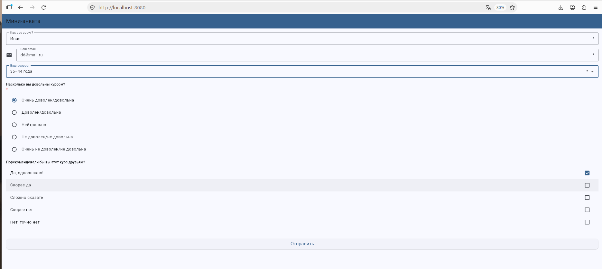
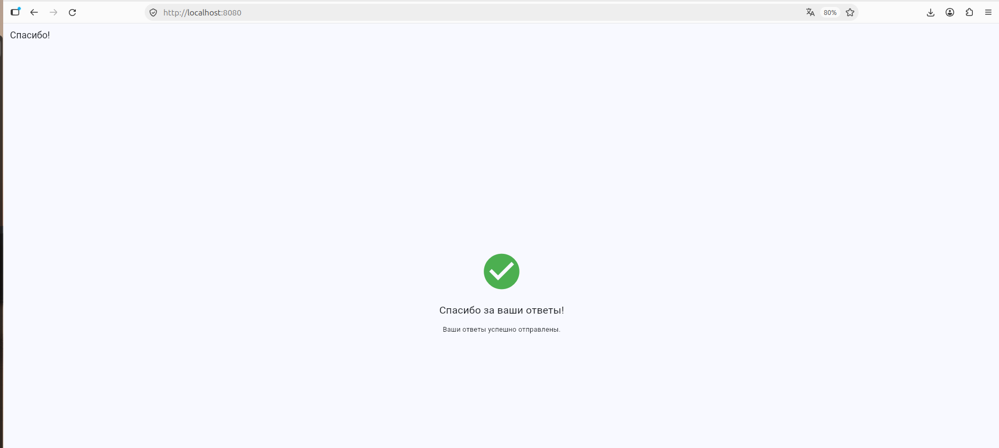
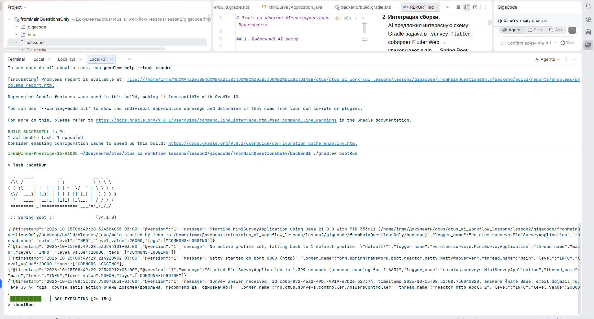

# Отчёт по обкатке AI-инструментария — Мини-анкета

## 1. Выбранный AI-setup

| Компонент       | Значение                                              |
|-----------------|-------------------------------------------------------|
| IDE / Редактор  | IntelliJ IDEA                                          |
| AI-ассистент    | GigaCode (Сбер)                                       |
| Модель          | встроенная модель GigaCode                             |
| Плагины         | плагин GigaCode для IDE                                |

Проект представляет собой full-stack приложение «Мини-анкета» (Mini Survey):
- **Backend** — Spring Boot 4.1 + Java 21, два эндпоинта: `GET /questions`, `POST /answers`.
- **Frontend** — Flutter Web, загружает вопросы, отображает форму, отправляет ответы, показывает «Спасибо!».
- **Интеграция** — Gradle-сборка в `survey_flutter/build.gradle.kts` собирает Flutter Web и упаковывает артефакт в zip, который затем извлекается в `backend/src/main/resources/static`.

---

## 2. Впечатления и мысли

### Что понравилось

1. **Генерация boilerplate-кода.**  
   Создание `build.gradle.kts`, `pubspec.yaml`, базовых Spring Boot-классов — всё было сгенерировано автоматически без ручного ввода.

2. **Интеграция сборки.**  
   AI предложил интересную схему: Gradle-задача в `survey_flutter` собирает Flutter Web → упаковывает в zip → Spring Boot извлекает артефакт в `resources/static`. Это позволяет использовать Flutter-приложение как статические ресурсы.

3. **Итеративность.**  
   Задачи типа «добавь таску на очистку сборки и привяжи к clean» или «привяжи zipFlutterWeb к assemble» выполнялись мгновенно — AI точно понимал контекст и вносил правки в нужные файлы.

### Что ускоряло работу

- Чётко сформулированные запросы на русском языке.
- AI сохранял контекст проекта и не забывал о предыдущих изменениях.
- Автоматическое соблюдение conventions проекта (Kotlin DSL, naming conventions).

### Что мешало или разочаровало

- **Медленная скорость генерации кода.** Ожидание ответов модели, сетевые задержки — иногда приходилось ждать по несколько секунд между отправкой промпта и получением ответа. Это прерывало поток работы и замедляло итерации.
- **Отсутствие визуальной обратной связи.** AI не видит файлы, пока ему не передашь их содержимое — это замедляет итерации, если нужно понять структуру без явного чтения файлов.
- **Необходимость проверять код.** Сгенерированный код требовал внимательного чтения — AI мог предложить неочевидные решения (например, хардкод пути к Flutter SDK в `build.gradle.kts`).
- **Баги в сгенерированном UI-коде.** AI мог сгенерировать код с неработающими элементами интерфейса (например, чекбоксы в Flutter без корректного обновления состояния), что требовало дополнительного указания на ошибку и исправления.

---

## 3. Возникшие проблемы

### Проблема 1: Путь к Flutter SDK в build.gradle.kts

**Что не получилось так:**  
Первоначально путь к Flutter SDK был захардкожен:
```kotlin
val flutterHome = System.getProperty("user.home") + "/Documents/Applications/flutter_linux_3.47.2-stable/flutter"
```

**Как чинили:**  
AI предложил сделать путь конфигурируемым — через property проекта, переменную окружения `FLUTTER_HOME` или fallback на стандартное расположение. Это сделало сборку переносимой.

### Проблема 2: Привязка Flutter-задач к стандартным Gradle-конвейерам

**Что не получилось так:**  
Flutter-задачи (`flutterBuild`, `zipFlutterWeb`) были в отдельной группе `flutter` и не вызывались автоматически.

**Как чинили:**  
Добавили зависимости:
```kotlin
tasks.clean {
    dependsOn(flutterClean)
}

tasks.assemble {
    dependsOn(zipFlutterWeb)
}
```
Теперь `./gradlew clean` очищает и Flutter-сборку, а `./gradlew assemble` собирает Flutter Web и упаковывает в zip.

### Проблема 3: Медленная генерация и сетевые задержки

**Что не получилось так:**  
Ответы модели приходилось долго ждать — генерация кода занимала время из-за сетевых задержек и нагрузки на сервер. Это создавало простои между итерациями.

**Как чинили:**  
Приходилось терпеливо ждать, параллельно анализируя предыдущий ответ или готовясь формулировать следующий промпт. На длинных генерациях (например, генерация всего backend'а) ожидание могло занимать значительное время.

### Проблема 4: Понимание контекста проекта

**Что не получилось так:**  
При первом запросе AI мог предложить стек, не соответствующий уже существующему (например, предложить React вместо Flutter).

**Как чинили:**  
Пришлось явно указывать текущий стек и предоставлять контекст (структуру проекта, существующие файлы). После этого AI точно попадал в контекст.

### Проблема 5: Неработающие чекбоксы в Flutter-анкете

**Что не получилось так:**  
AI сгенерировал форму анкеты с использованием `CheckboxListTile`, но чекбоксы не работали корректно — состояние не обновлялось при нажатии, ответы не сохранялись. Это было связано с неправильным использованием `setState` и отсутствием привязки значения к `value` в `CheckboxListTile`.

**Как чинили:**  
Пришлось дополнительно указать AI на данную ошибку, описать проблему с обновлением состояния. AI исправил код: добавил корректное хранение состояния для каждого вопроса в `Map<int, bool>`, правильно привязал `value` и `onChanged` в `CheckboxListTile`, вызывал `setState` при изменении состояния.

---

## 4. Вывод

**Выбор инструментария подтверждаю.**

GigaCode показал себя как эффективный инструмент для:
- Генерации boilerplate-кода (Gradle-конфиги, Spring Boot-классы, Flutter-структура).
- Быстрых итеративных изменений (добавление задач, привязка зависимостей).
- Работы на русском языке — без потери качества.

**Сильные стороны:**
- Хорошее понимание контекста при явном предоставлении файлов.
- Быстрое выполнение типовых задач (добавление Gradle-задач, генерация endpoints).
- Удобство итераций — правки вносятся точно и без лишних изменений.

**Слабые стороны:**
- Не видит проект «из коробки» — нужно явно передавать контекст.
- Сгенерированный код требует проверки (особенно хардкод путей, конфигураций и UI-логики — могли быть баги, например неработающие чекбоксы).
- Качество кода оставляет желать лучшего — местами он был избыточным, без следования best practices. Но это нормально, т.к. не были заранее сформулированы требования к качеству кода (архитектурные паттерны, тесты, кодстайл).
- На сложных архитектурных решениях пока требуется больше контроля со стороны разработчика.

**Итог:** GigaCode — подходящий инструмент для обкатки full-stack приложений. Для курса OTUS он полностью подходит, и опыт работы подтверждает его практическую ценность.

---

## Скриншоты

### Внешний вид анкеты в браузере



### Подтверждение приёма анкеты сервером



### Лог результата анкеты на сервере



---

## Список промптов

Полный список всех промптов, использованных в ходе работы, приведён в файле [ai_requests.md](ai_requests.md).
