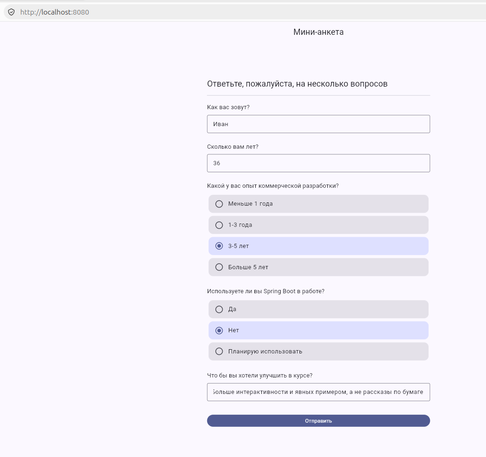
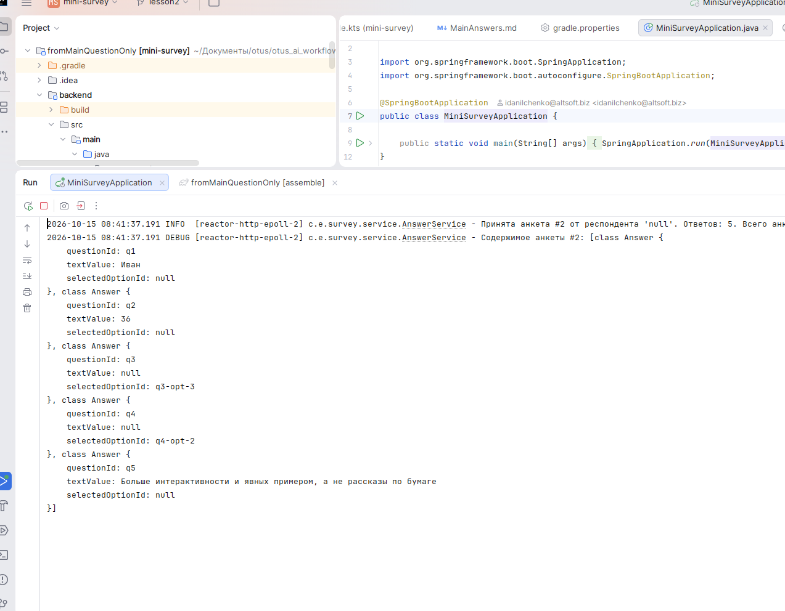
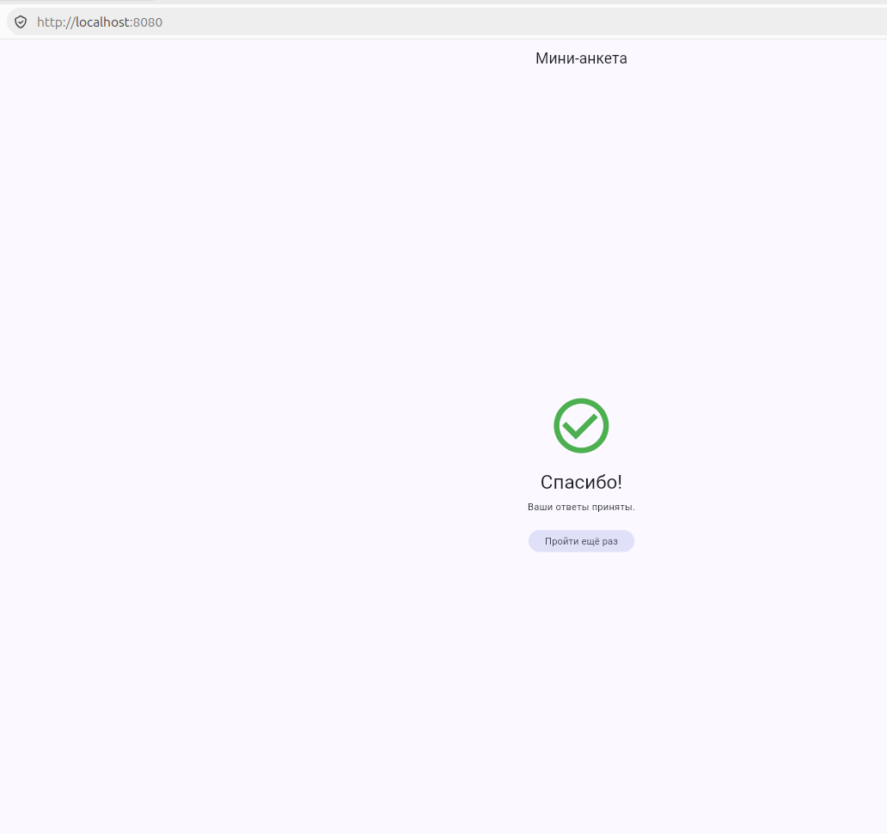

# REPORT.md — Обкатка AI-инструментария на генерации приложения «Мини-анкета»

## 0. Задача и результат

Собрано минимальное full-stack приложение «Мини-анкета»:

- **Backend**: Java 25 + Spring Boot 4.1.1 + Spring WebFlux, сборка Gradle Kotlin DSL.
  - `GET /questions` — список из 5 вопросов, загружается из `questions.json`.
  - `POST /answers` — приём ответов, хранение в памяти (`ConcurrentHashMap`),
    логирование в stdout через logback.
  - Отдаёт собранное Flutter Web приложение как статику из `classpath:/static/`.
- **Frontend**: Dart / Flutter 3.47 (Web) — загружает вопросы, строит анкету,
  отправляет ответы, показывает «Спасибо!» по центру экрана.
- **Протокол**: `protocol/openapi.yaml` — единый контракт, из которого
  генерируются Java-модели/интерфейс сервера и Dart-клиент фронтенда.
- **Сборка**: единый Gradle-проект `:backend` + `:frontend`; Flutter-сборка
  публикуется zip-артефактом в mavenLocal, backend скачивает и распаковывает его
  в `src/main/resources/static`.

Проверено вручную: `GET /questions` возвращает вопросы, `POST /answers` сохраняет
и отвечает `Спасибо!`, `GET /` отдаёт `index.html`, `/main.dart.js` — собранный UI.

---

## 1. Выбранный AI-setup

| Компонент | Выбор |
|---|---|
| IDE | IntelliJ IDEA |
| Ассистент/агент | OpenCode (CLI-агент) |
| Модель | big-pickle |
| Плагины | дополнительные не использовались |
| Протокол/контракт | OpenAPI Generator 7.14.0 (Gradle-плагин) |
| Backend | JDK 25, Spring Boot 4.1.1, Spring WebFlux, Gradle Kotlin DSL 9.6.1 |
| Frontend | Flutter 3.47.2 / Dart 3.13.2 |

Настройка: проект — единый Gradle multi-project (`settings.gradle.kts` включает
`:backend` и `:frontend`). Контракт вынесен в отдельную папку `protocol/`, генерация
кода подключена к сборке, поэтому руки к сгенерированным моделям не прикладываются.

---

## 2. Рассмотренные альтернативы

- **Ассистент**: рассматривались Cursor и GitHub Copilot как «встроенные» варианты,
  но выбран OpenCode — он работает как агент прямо в терминале/IDE, умеет запускать
  сборку, читать stdout и итеративно чинить ошибки без переключения контекста.
- **Backend-стек**: Python/FastAPI и Node.js/Express проще «в лоб», но Spring WebFlux
  выбран сознательно — цель обкатать инструмент на реактивном стеке Spring, где
  генерация кода из OpenAPI и связка с Gradle дают больше материала для проверки.
- **Frontend-стек**: HTML+JS отвергнут как слишком простой для проверки агента;
  Flutter выбран, чтобы проверить генерацию Dart-клиента и сборку web-артефакта.
- **Способ синхронизации фронта и бэка**: ручные DTO vs. генерация из OpenAPI.
  Выбран OpenAPI — единый источник истины, обе стороны генерируются из одного файла,
  рассинхрон по именам полей исключён конструктивно.
- **Доставка фронта в бэк**: отдельный web-сервер vs. встраивание статики. Выбран
  вариант с zip-артефактом в mavenLocal и распаковкой в `resources/static`, как
  задано в ТЗ.

---

## 3. Впечатления и мысли

Что понравилось / ускоряло работу:

- Быстрая генерация каркаса проекта и «скелетов» файлов; OpenAPI-контракт и оба
  генератора (Java и Dart) были подняты с первой-второй попытки.
- Агент самостоятельно находил причину ошибок по выводу компилятора (например,
  переход Spring Boot 4 на Jackson 3) и предлагал точечную правку.
- Единая Gradle-сборка с зависимостями задач получилась аккуратной: одна команда
  `./gradlew :backend:bootJar` прогоняет всю цепочку (генерация → Flutter build →
  публикация → распаковка → jar).

Что мешало / разочаровало:

- Модель «из коробки» не знает про Jackson 3 в Spring Boot 4 — понадобилась
  правка импортов вручную.
- Dart-генератор OpenAPI генерирует несовместимый с web код (`dart:io`) — это
  пришлось обходить пост-обработкой.
- Мелкие несоответствия в конфигурации генератора (`sourceFolder`) приводили к
  неочевидной структуре каталогов (`lib/lib/...`).

---

## 4. Возникшие проблемы и как их обходили

### 4.1. Jackson 3 в Spring Boot 4

**Симптом:** `compileJava` падает с `package com.fasterxml.jackson.databind does not exist`
в `QuestionService`.

**Причина:** Spring Boot 4 / Spring Framework 7 перешли на **Jackson 3**, у которого
пакеты `tools.jackson.*`, а не `com.fasterxml.jackson.*`.

**Решение:** заменить импорты на `tools.jackson.databind.ObjectMapper` и
`tools.jackson.core.type.TypeReference`. Аннотации в сгенерированных моделях
остались в старом пакете `com.fasterxml.jackson.annotation.*` (Jackson 3 их сохраняет)
— их менять не потребовалось.

### 4.2. Dart-клиент несовместим со сборкой под web

**Симптом:** `flutter build web` падает:
```
Error: The 'class-modifiers' language feature is disabled for this library.
Error: The language version override has to be the same in the library and its part(s).
Error: 'SocketException' isn't a type.
Error: 'TlsException' isn't a type.
Error: 'IOException' isn't a type.
```

**Причина:** сгенерированный dart-клиент импортирует `dart:io` ради `HttpStatus`
и типов исключений `SocketException`/`TlsException`/`IOException`. На web `dart:io`
недоступен. Плюс все файлы помечены `// @dart=2.18`, где модификаторы классов из Dart 3
недоступны.

**Решение:** пост-обработка в Gradle-задаче `generateSurveyApi` (проект `:frontend`):
- удаляется строка `import 'dart:io';` из `lib/api.dart`;
- подкладывается `lib/io_shims.dart` с `// @dart=2.18` и обычными классами
  `HttpStatus`, `SocketException`, `TlsException`, `IOException`;
- в `lib/api.dart` добавляется `part 'io_shims.dart';`.

После этого web-сборка прошла.

### 4.3. Вложенность `lib/lib/` в сгенерированном Dart-клиенте

**Симптом:** файлы оказались в `generated_api/lib/lib/api/...` вместо `lib/api/...`.

**Причина:** в конфигурацию генератора был добавлен `sourceFolder=lib`, а генератор
и так кладёт исходники в `lib`.

**Решение:** убрать `sourceFolder` из `configOptions`.

### 4.4. Падение `flutter analyze`

**Симптом:** `flutter analyze` завершается с `analysis server exited with code 255`
и стектрейсом, реальных замечаний не показывает.

**Решение:** проверка через `dart analyze lib` — `No issues found!`. Падение самого
analysis-сервера не связано с кодом приложения.

### 4.5. Подпись сгенерированного интерфейса

**Наблюдение:** генератор вернул `Mono<ResponseEntity<Flux<Question>>>` для `GET /questions`
и `@RequestBody Mono<AnswerSubmission>` для `POST /answers`.

**Решение:** контроллер реализует интерфейс ровно с этими типами
(`ResponseEntity.ok(Flux.fromIterable(...))`), что соответствует реактивному стеку.

### 4.6. Незначительное: `@Valid` на контейнере

**Симптом:** в логах предупреждение Hibernate Validator HV000271
(`@Valid` на `List` устарел).

**Решение:** оставлено как есть — предупреждение не влияет на работу, а правка
сгенерированного кода нежелательна.

### 4.7. Не очищались артефакты сборки Flutter при `clean`

**Симптом:** после `./gradlew clean` каталоги `frontend/app/build` и
`frontend/app/.dart_tool` оставались на месте.

**Причина:** плагин `base` в модуле `:frontend` знал только о своём
`layout.buildDirectory` (`frontend/build`), тогда как `flutter build web`
выполняется в каталоге `frontend/app`. Gradle не мог удалить то, о чём не знал.

**Решение:** добавлена задача `cleanFlutterApp` (`Delete`), удаляющая `app/build`
и `app/.dart_tool`, и подключена к жизненному циклу `clean`; у `flutterPubGet`
добавлен выход `.dart_tool/package_config.json`, чтобы после очистки `pub get`
не считался `UP-TO-DATE`. Проверено: `./gradlew clean` теперь удаляет все три
каталога, а последующий `flutterPubGet` выполняется заново.

---

## 5. Дополнительные итерации: документация и гигиена репозитория

После того как приложение собралось и заработало, были выполнены небольшие
поддерживающие задачи (полные промпты — в `ai_requests.md`, разделы 6–10):

- **`.gitignore`.** По запросу создан корневой `.gitignore` с секциями Gradle
  (`.gradle/`, `build/`), IDE (`.idea/`, `*.iml`, `.vscode/`, Eclipse/NetBeans),
  Flutter/Dart (`.dart_tool/`, `.pub-cache/`, `**/doc/api/` и др.), а также
  паттерном `backend/src/main/resources/static/` для распакованного веб-артефакта.
- **Инструкция по сборке в `README.md`.** Добавлен блок «Быстрый старт» (две
  команды) и «Полная пересборка с нуля»; все команды переведены на `./gradlew`
  (обёртка входит в репозиторий), уточнены требования.
- **Журнал промптов.** `ai_requests.md` дополнялся по ходу сессии (разделы про
  «продолжай», фикс `clean`, `.gitignore`, static, README).

Наблюдение по инструменту: на этих мелких задачах агент работал без ошибок с
первой попытки — объём и однозначность запроса здесь выше, чем у многошаговой
сборки full-stack проекта.

---

## 6. Вывод

Выбор инструментария **подтверждён**. OpenCode с моделью big-pickle позволил
пройти путь от пустой папки до работающего full-stack приложения с единой
Gradle-сборкой, генерацией кода из OpenAPI и встроенным в backend Flutter Web.

Сильные стороны на этой задаче: способность вести многошаговую сборку, читать
вывод компиляторов/сборщиков и точечно чинить ошибки, держать в голове структуру
multi-project сборки. Слабые стороны: незнание актуальных breaking changes
(Jackson 3 в Spring Boot 4, несовместимость dart-генератора с web), из-за чего
часть правок делалась после реального прогона сборки, а не «на опыте».

Инструмент пересматривать не планирую — расхождения лежали в свежести версий
фреймворков, а не в подходе, и устранялись в диалоге за 1–2 итерации.

---

## Приложение А. Промпты

Полная история промптов и связанных с ними генераций — в [`ai_requests.md`](ai_requests.md).

## Приложение Б. Как воспроизвести

```bash
./gradlew clean :backend:bootJar
java -jar backend/build/libs/backend-1.0.0.jar
# открыть http://localhost:8080
```

Подробнее — в `README.md`.

## Приложение В. Скриншоты

**Внешний вид анкеты в браузере**



**Лог сервера с результатом анкеты**



**Подтверждение того, что анкета принята сервером**


